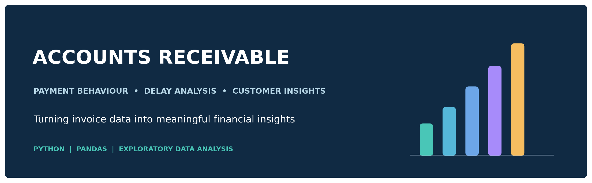
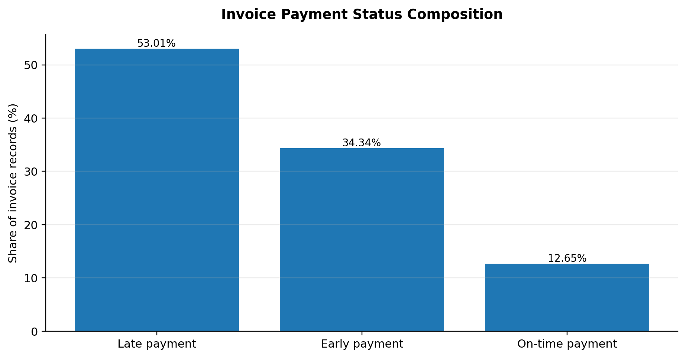
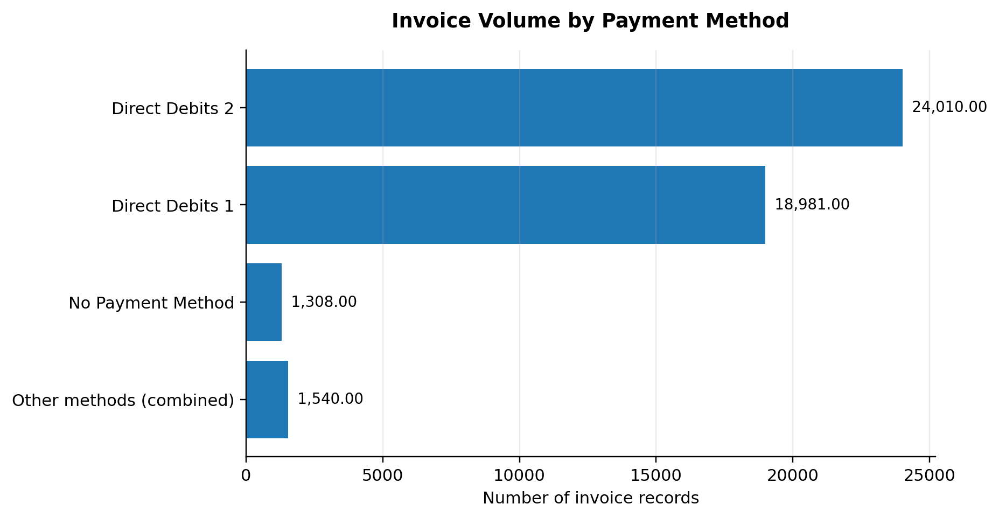
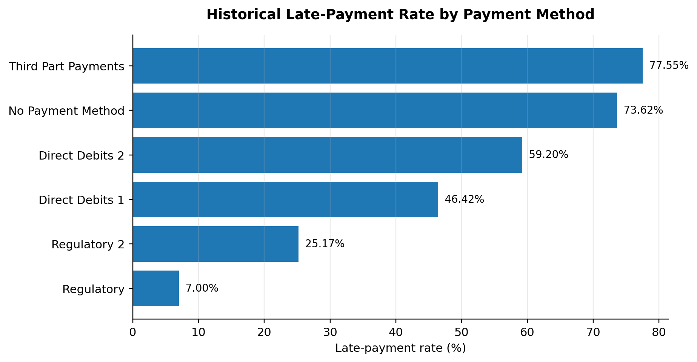
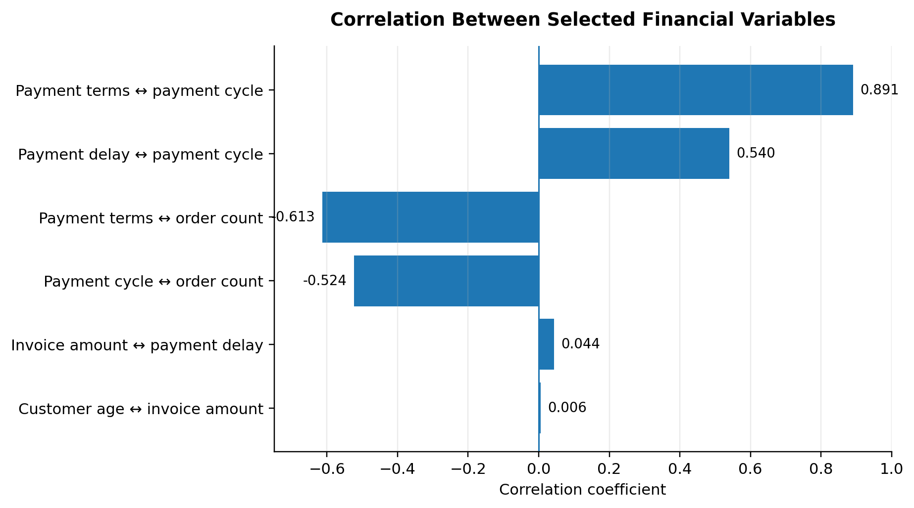

<div align="center">📊 Accounts Receivable Analysis

  Historical Invoice Payment Behaviour, Payment Delays & Customer Insights

  👤 Author: Indu A  

📧 LinkedIn: www.linkedin.com/in/indua24
<p>
  
  
  
  
  
  
</p>
A Python-based data analytics project exploring invoice settlement patterns, payment delays, payment methods and customer-level receivables behaviour.

</div>📌 Project Overview

Accounts Receivable (AR) is an important part of financial operations because delayed customer payments can affect cash-flow visibility, working capital and collection efficiency.

This project analyses historical invoice-level records to understand how customers settle invoices, how payment delays vary, and whether payment terms and payment methods are associated with settlement behaviour.

Using Python and its data analysis libraries, the project follows a structured workflow covering data understanding, data quality assessment, preprocessing, feature engineering, exploratory data analysis (EDA), customer-level analysis and business recommendations.

The objective is to transform raw invoice data into meaningful insights that can support better Accounts Receivable monitoring and collection prioritisation.

Business Problem

Receivables teams need a structured way to understand where payment delays occur and how recorded payment behaviour varies across customers, payment terms, invoice amounts, payment methods and regions. Without a consistent analytical view, it can be difficult to identify recurring patterns, decide which accounts warrant further review and communicate collection trends clearly.

Central business question: What patterns in invoice amounts, payment terms, customer and regional information, and recorded payment delays can help explain historical settlement behaviour and support more focused receivables follow-up?

The analysis identifies patterns for further review. It does not assume that an observed relationship proves the cause of a payment delay.

Analytical Scope and Interpretation

This project uses the fields available in the dataset and validates their meaning before drawing conclusions. In particular, Amount is treated as a recorded document amount; it is not automatically interpreted as an outstanding balance. Currency, amount units, payment-delay definitions, clearing status and the unit of observation must be confirmed against the source documentation and the data itself.
Project focus: This is a historical invoice-payment behaviour analysis. The available results do not establish live open invoice balances or current overdue ageing. A separate open-item dataset with balances and a defined reporting date would be required for operational ageing and collection monitoring.

🎯 Project Objectives

- Inspect the structure, completeness and quality of the Accounts Receivable dataset.
- Validate the unit of observation and the definitions of amount, payment terms, delay fields, clearing status and date fields.
- Identify missing values, blank text values, exact duplicates, inconsistent categories and implausible records.
- Clean and standardise invoice, customer, payment and date fields using documented steps.
- Create payment-status, payment-cycle and clearing-time features where the source fields support them.
- Analyse the distribution of recorded payment delays and early, on-time and late payment categories.
- Explore how historical delays vary across payment terms, invoice-amount categories and payment methods.
- Compare customer and regional patterns where record counts and field definitions support meaningful comparisons.
- Examine invoice, due, posting and clearing dates, including weekday and quarterly patterns where valid.
- Present evidence-based findings, visualisations, limitations and practical recommendations for further receivables review.

📂 Dataset Information

Source	Kaggle – 
File format	CSV
Invoice records analysed	45,839
Customer summary	69 unique customers
Initial columns	29
Main subject	Customer invoices, payment terms, payment methods, due dates and clearing activity


## 📂 Key Dataset Attributes

| Column Name | Description | Data Type |
|---|---|---|
| `Cust_Num` | Unique customer identification number | Identifier |
| `Customer_Name` | Customer name | Text |
| `Document_No` | Invoice or document reference number | Identifier |
| `Amount` | Recorded invoice/document amount | Numeric |
| `Payment_Method_description` | Description of payment method | Categorical |
| `Payment_Term` | Recorded payment terms | Numeric / Categorical |
| `Payment_Term_Bins` | Grouped payment-term categories | Categorical |
| `Days_Overdue_Delay` | Recorded payment delay in days | Numeric |
| `Delay_Bins` | Grouped payment-delay categories | Categorical |
| `Doc_Date` | Invoice/document date | Date |
| `Net_Due_Date` | Invoice due date | Date |
| `Posting_Date` | Financial posting date | Date |
| `Clearing_date` | Invoice clearing date | Date |
| `Region` | Customer region | Categorical |
| `City` | Customer city | Categorical |
| `Amount_Bins` | Grouped invoice amount categories | Categorical |
| `DelayFlag` | Recorded payment-delay indicator | Categorical / Flag |
| `Weekday_clearing` | Weekday of invoice clearing | Categorical |
| `Quarter_clearing` | Quarter of invoice clearing | Categorical |


## 🔍 Dataset Validation Checklist

| Field / Attribute | Validation Check | Purpose |
|---|---|---|
| `Cust_Num` | Check missing values, unique customer IDs and consistency | Ensure accurate customer identification |
| `Customer_Name` | Check blank values, spelling variations and anonymisation | Maintain customer-name consistency |
| `Document_No` | Identify duplicate document numbers and repeated records | Verify document-level uniqueness |
| `Amount` | Check missing values, negative values, outliers and currency | Validate financial amounts |
| `Payment_Method_description` | Identify missing values and inconsistent category names | Standardise payment methods |
| `Payment_Term` | Check missing values, data types and unusual values | Validate payment-term information |
| `Payment_Term_Bins` | Verify category definitions and grouping logic | Ensure correct payment-term classification |
| `Days_Overdue_Delay` | Check negative values, extreme delays and calculation logic | Validate payment-delay information |
| `Delay_Bins` | Verify delay categories and boundaries | Ensure consistent delay classification |
| `Doc_Date` | Check date format and missing values | Validate invoice dates |
| `Net_Due_Date` | Check date format and chronological consistency | Validate invoice due dates |
| `Posting_Date` | Check date format and missing values | Validate posting information |
| `Clearing_date` | Check missing values and date consistency | Validate invoice settlement dates |
| `Region` | Check missing values and inconsistent labels | Standardise regional information |
| `City` | Check missing values and spelling variations | Maintain location consistency |
| `Amount_Bins` | Verify amount ranges and category boundaries | Validate amount classification |
| `DelayFlag` | Compare flag values with payment-delay logic | Verify payment-delay indicators |
| `Weekday_clearing` | Compare weekday values with clearing dates | Validate weekday classification |
| `Quarter_clearing` | Compare quarter values with clearing dates | Validate quarterly classification |


🛠️ Tools & Technologies
Tool / Library	Purpose
Python	Main programming language
Jupyter Notebook	Interactive analysis environment
Pandas	Data loading, cleaning, grouping and aggregation
NumPy	Numerical operations and feature engineering
Matplotlib	Static data visualisation
Seaborn	Statistical visualisation
Plotly Express	Interactive exploratory charts


🔍 Project Workflow
The project follows a step-by-step data analytics process.
1. Data Understanding and Field Validation
- Imported the required Python libraries and loaded the CSV file into a Pandas DataFrame.
- Examined sample records, dataset dimensions, column names, data types and unique values.
- Reviewed descriptive statistics and the meaning of key fields against the available source documentation.
- Checked the likely unit of observation and distinguished repeated customer identifiers from possible duplicate transactions.
- Flagged the currency and exact meaning of Amount, and the definitions of delay and clearing fields, for validation before interpretation.
2. Data Quality Assessment
- Checked missing values and null percentages.
- Checked blank values in text columns.
- Identified exact duplicate records.
- Reviewed data types and date fields.
- Inspected unusual values and extreme observations.
3. Data Cleaning & Preprocessing
- Created a separate working copy of the original dataset.
- Standardised column names using lowercase and underscore formatting.
- Converted document, due, posting and clearing date columns into datetime format.
- Trimmed unnecessary spaces from text columns.
- Reviewed missing values and duplicate records.
- Checked numerical fields and descriptive statistics.
4. Feature Engineering
Created additional fields to support payment analysis.
Feature	Definition
payment_status	Early Payment when delay < 0; On-Time Payment when delay = 0; Late Payment when delay > 0
payment_cycle_days	Clearing date minus document date, in days
clearing_year	Year extracted from clearing date
clearing_month	Month extracted from clearing date
clearing_quarter	Quarter extracted from clearing date


Payment status logic:

df_clean["payment_status"] = np.where(
df_clean["days_overdue_delay"] < 0,
"Early Payment",
np.where(
df_clean["days_overdue_delay"] == 0,
"On-Time Payment",
"Late Payment"
)
)

Payment cycle calculation:

df_clean["payment_cycle_days"] = (
df_clean["clearing_date"] - df_clean["doc_date"]
).dt.days
5. Customer-Level Analysis
Grouped invoice records by customer number to create a customer payment summary.

The customer-level analysis includes:
- Total invoice count
- Total recorded invoice amount
- Average payment delay
- Maximum payment delay
- Early payment count
- On-time payment count
- Late payment count
- Late-payment rate
Late-payment rate formula:
late_payment_rate = (
    late_payments / total_invoices
) \* 100

### 6\. Exploratory Data Analysis (EDA)

The analysis is organised into three approaches:

* **Univariate Analysis** – examines individual variables and their distributions.
* **Bivariate Analysis** – explores relationships between two variables.
* **Multivariate Analysis** – examines combined relationships among multiple financial and customer variables.

## 📈 Key Performance Indicators

The following metrics are reported in the notebook:

|**KPI**|**Result**|
|---|---:|
|Total invoice records|**45,839**|
|Unique customers in customer summary|**69**|
|Late-payment invoices|**24,299**|
|Late-payment share|**53.01%**|
|Early-payment invoices|**15,743**|
|Early-payment share|**34.34%**|
|On-time-payment invoices|**5,797**|
|On-time-payment share|**12.65%**|
|Average payment delay|**0.97 days**|
|Median payment delay|**1 day**|
|Maximum recorded payment delay|**1,257 days**|
|Average payment cycle|**14.76 days**|
|Median payment cycle|**6 days**|
|Average invoice amount|**17,807.16**|
|Median invoice amount|**3,196**|

## 📊 Data Visualizations & Analysis

### 1\. Payment Status Distribution

The payment status analysis compares early, on-time and late invoice records.



**Key observation:** Late payments represent 53.01% of the invoice records and form the largest payment-status category.

### 2\. Invoice Volume by Payment Method

This analysis identifies the payment methods most frequently recorded in the dataset.



**Key observation:** Direct Debits 2 and Direct Debits 1 account for the majority of invoice records.

### 3\. Late-Payment Rate by Payment Method

The chart compares the historical late-payment percentage across selected payment methods.



**Key observation:** Third Part Payments and No Payment Method have the highest reported late-payment rates among the listed categories. Lower-volume categories should be interpreted carefully.

### 4\. Correlation Analysis

Correlation analysis explores the direction and strength of relationships between selected financial variables.



**Key observation:** Payment terms and payment cycle days show a strong positive correlation of approximately 0.891. Invoice amount and payment delay show a very weak correlation of approximately 0.044.

### Additional Analyses 

* Invoice amount distribution.
* Payment delay distribution.
* Payment terms vs. payment cycle.
* Invoice amount vs. payment delay.
* Invoice amount by payment status.
* Payment method vs. payment delay.
* Payment status composition by payment method.
* Customer payment behaviour and invoice exposure.
* Correlation matrix of selected numerical variables.

## Key Findings & Business Insights

### 1\. Late Payment Is the Largest Category

* 24,299 invoice records (53.01%) are classified as late.
* 15,743 records (34.34%) are classified as early payments.
* 5,797 records (12.65%) are classified as on-time payments.

This indicates that late payment is the largest category in the historical records.

### 2\. Invoice Amounts Are Positively Skewed

* Average invoice amount: approximately 17,807.16.
* Median invoice amount: 3,196.
* Maximum recorded invoice amount: 5,709,354.

The difference between the mean and median indicates that high-value records influence the average. Median and percentile measures should therefore be considered alongside the mean.

### 3\. Payment Delays Include Extreme Values

* Average payment delay: approximately 0.97 days.
* Median payment delay: 1 day.
* Minimum recorded delay: −117 days.
* Maximum recorded delay: 1,257 days.

Negative delay values represent early settlement under the notebook's classification rule. Some historical records show exceptionally long delays.

### 4\. Payment Method Performance Varies

|**Payment Method**|**Late-Payment Rate**|
|---|---:|
|Third Part Payments|**77.55%**|
|No Payment Method|**73.62%**|
|Direct Debits 2|**59.20%**|
|Direct Debits 1|**46.42%**|
|Regulatory 2|**25.17%**|
|Regulatory|**7.00%**|

Third Part Payments has the highest reported late-payment rate. Payment method alone should not be treated as the cause of late payment.

### 5\. Payment Terms and Payment Cycle

The correlation between payment terms and payment cycle days is approximately **0.891**, indicating a strong positive association.

This suggests that invoices with longer payment terms generally tend to have longer payment cycles in the analysed records. Correlation does not prove causation.

### 6\. Invoice Amount and Payment Delay

The correlation between invoice amount and payment delay is approximately **0.044**, indicating a very weak positive linear relationship.

Invoice value alone is therefore not a strong indicator of historical payment delay in this dataset.

### 7\. Customer Payment Behaviour

The customer summary includes 69 unique customers.

* Customer `5039221094` has the highest total recorded invoice amount: approximately 227,964,488 across 9,712 invoices.
* Customer `5039221090` has the highest invoice count: 10,219.
* Customer `5039221093` has a late-payment rate of 77.73% and average delay of 3.60 days.
* Customer `5039221097` has a late-payment rate of 71.11% and average delay of 20.13 days.
* Customer `5039221071` has an average delay of −23.58 days, indicating early-payment behaviour on average.

## 🎯 Recommendations

1. Prioritise further review of customers with both high invoice exposure and high late-payment rates.
2. Investigate customers with unusually high average or maximum payment delays.
3. Review payment terms against actual payment cycles.
4. Examine payment methods with higher historical late-payment rates, while considering the number of invoices in each category.
5. Use median and percentile measures alongside averages to account for extreme invoice amounts and delays.
6. Build a separate open-invoice ageing report for current collection monitoring.

## ⚠️ Limitations & Assumptions

* The analysis is based on historical invoice/payment records and does not establish current open invoice balances.
* A current outstanding receivables balance and current overdue ageing cannot be calculated from the reported notebook results alone.
* The currency and exact unit of the `amount` field are not confirmed.
* The definitions and derivation of supplied delay fields should be checked against the original dataset documentation.
* Correlation indicates association, not causation.
* Payment-method categories with fewer records may have less stable rates.
* Customer identifiers should be anonymised if necessary before public publication.
* This is a descriptive analysis, not a predictive credit-risk model or collection forecast.

## 🚀 Future Scope

* Include invoice open/cleared status and outstanding balances as at a defined reporting date.
* Calculate overdue days for open invoices only.
* Create ageing buckets: Not Due, 1–30, 31–60, 61–90 and 90+ days.
* Include collection owner, dispute status, promised payment date and last follow-up date where available.
* Develop a Power BI dashboard with total outstanding, overdue amount, overdue percentage, top overdue customers and ageing trends.
* Explore predictive analysis after validating data definitions and collecting suitable historical outcomes.

## 📁 Suggested GitHub Repository Structure

```text
Accounts-Receivable-Analysis/
│
├── README.md
├── images/
│   ├── ar_project_banner.png
│   ├── payment_status.png
│   ├── payment_method.png
│   ├── late_rate.png
│   └── correlations.png
│
├── notebooks/
│   └── Accounts_Receivable_Analysis.ipynb
│
├── data/
│   ├── raw/
│   │   └── Account receivable analysis data set.csv
│   └── processed/
│       ├── Accounts_Receivable_Cleaned.csv
│       └── Customer_Payment_Analysis.csv
│
├── reports/
│   └── Accounts_Receivable_Analysis_Project_Report.docx
│
└── requirements.txt

📦 Project Outputs
Processed files:
Output File	Description
Accounts_Receivable_Cleaned.csv	Cleaned invoice-level data with engineered payment features
Customer_Payment_Analysis.csv	Customer-level invoice and payment behaviour summary


🧭 Project Status and Development Phases
Phase	Focus	Project documentation
Phase 1 – Project Proposal and Initial Inspection	Business problem, objectives, dataset structure, key fields and validation requirements	Project overview and dataset inspection
Phase 2 – Data Cleaning and Preparation	Data-quality checks, date conversion, standardisation and payment-related feature engineering	Cleaning and preprocessing workflow
Phase 3 – Exploratory Data Analysis	Payment-status distribution, delay patterns, payment methods, customer summaries and relationships between variables	KPIs, charts and findings in this README and the analysis notebook


📝 Conclusion
This project analyses 45,839 historical invoice records across 69 customers to understand payment delays, payment cycles, payment methods and customer payment behaviour.

The findings show that 53.01% of invoice records are classified as late payments. Payment terms have a strong positive association with payment cycle days, while invoice amount alone has a very weak relationship with payment delay. Payment behaviour also varies across payment methods and customers.

The project demonstrates how Python-based data cleaning, feature engineering, exploratory data analysis and visualisation can turn invoice data into meaningful Accounts Receivable insights. Adding current open balances and invoice ageing would be the next step toward a practical collection-monitoring solution.
<div align="center">✨ Better Data. Clearer Insights. Smarter Receivables Decisions.
Accounts Receivable Analysis | Python Data Analytics Project
</div>

